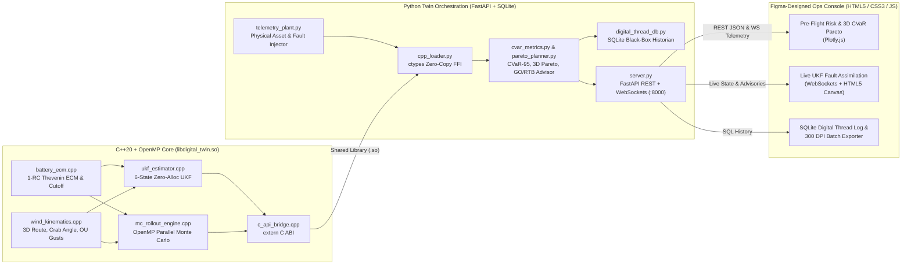

# Mission-Level Digital Twin for UAV Operations

A bidirectional, physics-based Mission-Level Digital Twin for tactical electric fixed-wing Unmanned Aerial Vehicles (UAVs), combining a compiled **C++20 / OpenMP** deterministic physics, Unscented Kalman Filter (UKF), and parallel Monte Carlo engine with a **Python FastAPI + SQLite Digital Thread** backend and a **Figma-designed HTML5 / CSS3 / Vanilla JavaScript** Mission Operations Console.

- **Figma UI/UX Design System**: [UAV Mission-Level Digital Twin — Ops Console](https://www.figma.com/design/iHhRuAaPgPHVQPTT3bxsxU)

---

## 1. Problem Statement

Operational mission planning for electric Unmanned Aerial Vehicles requires substantially more than nominal vehicle-level performance estimates; it demands holistic, probabilistic evaluation of energy availability, terminal voltage safety, mission timing, and operational risk under real-world uncertainty. Conventional flight planners rely on static point-performance spreadsheets that treat battery depletion as linear, ignore crosswind and reciprocal Return-to-Base wind projections, and provide no mechanism to revise risk predictions once the aircraft encounters unexpected headwind shear, airframe icing, or battery cell aging mid-flight.

This project develops a bidirectional, mission-level digital twin to assess UAV mission feasibility before deployment and continuously track vehicle health during flight. By pairing a 1-RC Thevenin electro-thermal battery model and 3D wind-aware flight kinematics with online Bayesian data assimilation (6-state Unscented Kalman Filter) and multi-threaded Monte Carlo tail-risk estimation, the framework transforms pre-flight Go/No-Go assessment and live in-flight supervisory re-planning into rigorous, quantitative decision support.

---

## 2. System Architecture

The system follows a decoupled three-layer Digital Twin architecture connecting compiled C++20 flight physics and estimation directly to Python risk analytics, a relational SQLite Digital Thread black-box historian, and a real-time browser operations console served over a single port:



---

## 3. Mathematical and Physical Formulations

### 3.1 1-RC Thevenin Electro-Thermal Battery Model (Plett 2004; Hogge & Bole NASA 2018)
For a realistic $10\,\text{kg}$ Group-2 UAV equipped with a $344\,\text{Wh}$ 6S Li-ion pack ($22.2\,\text{V}$ nominal, $15.5\,\text{Ah}$, $18.8\,\text{V}$ cutoff), discharge current $I(t)$ under electrical power demand $P_{\text{elec}}$ is solved analytically from the quadratic terminal voltage balance:
$$V_{\text{term}}(t) = V_{\text{oc}}(\text{SOC}) - I(t) R_0(T, \text{SOH}) - V_p(t)$$
$$\dot{\text{SOC}}(t) = -\frac{I_{\text{eff}}(t)}{3600 \, Q_{\text{nom}}}, \qquad \dot{V}_p(t) = -\frac{V_p(t)}{R_1 C_1} + \frac{I(t)}{C_1}$$
where high-rate discharges above $1\text{C}$ incur Traub Peukert derating $I_{\text{eff}} = I (I / I_{\text{ref}})^{k_p - 1}$. Unlike linear coulomb counting, this formulation captures realistic **under-voltage brownout** ($V_{\text{term}} \le V_{\text{cutoff}}$) during high-power climb or aged-cell gusts prior to zero SOC.

### 3.2 3D Vector Wind Kinematics, Banked Loiter & Reciprocal RTB (Langelaan 2007)
Along any 3D waypoint leg with horizontal unit track vector $\hat{\mathbf{u}}$ and stochastic wind $\mathbf{W}(t) = \bar{\mathbf{W}} + \mathbf{w}_{\text{OU}}(t)$ driven by an Ornstein-Uhlenbeck turbulence process, the groundspeed accounting for crosswind crab angle $\beta_{\text{crab}} = \arcsin(W_{\perp} / V_a)$ is:
$$W_{\parallel} = \mathbf{W} \cdot \hat{\mathbf{u}}, \qquad V_g = \sqrt{\max(V_a^2 - W_{\perp}^2, 1.0)} + W_{\parallel}$$
Because Return-to-Base reverses the waypoint order ($\hat{\mathbf{u}}_{\text{RTB}} = -\hat{\mathbf{u}}_{\text{out}}$), headwinds outbound automatically become tailwinds on return, correcting the legacy opposite-wind sign fallacy. Total electrical power properly accounts for propulsion efficiency $\eta_{\text{prop}}$, avionics/payload hotel power $P_{\text{hotel}}$, climb potential energy $W V_z$, and banked-loiter load factor $n = 1 / \cos\phi$:
$$P_{\text{elec}} = \frac{\max\left(\frac{1}{2}\rho(h) V_a^3 S \left[(C_{D0} + \Delta C_{D0}) + k \left(\frac{n W}{\frac{1}{2}\rho(h) V_a^2 S}\right)^2\right] + W V_z, \; 0\right)}{\eta_{\text{prop}}} + P_{\text{hotel}}$$

### 3.3 Bidirectional Data Assimilation via 6-State C++20 UKF (Kapteyn et al. 2021)
To close the physical-to-virtual loop during flight, a stack-allocated C++20 Unscented Kalman Filter continuously estimates the augmented state vector from noisy onboard measurements $\mathbf{z} = [V_{\text{term}}, V_{g,N}, V_{g,E}, P_{\text{elec}}]^T$:
$$\hat{\mathbf{x}} = \left[ \text{SOC}, \; V_p, \; R_0, \; \Delta C_{D0}, \; W_N, \; W_E \right]^T$$
When mid-flight anomalies occur—such as airframe icing increasing parasitic drag ($\Delta C_{D0}$) or battery internal resistance jumping ($R_0$)—the UKF updates its posterior mean and $6 \times 6$ covariance directly inside the C++ core and re-seeds the OpenMP forward Monte Carlo rollout engine.

### 3.4 Coherent Tail Risk ($\text{CVaR}_{95\%}$) & Supervisory Planning (Rockafellar & Uryasev 2000; Majumdar & Pavone 2019)
Over $N$ stochastic trajectories, defining reserve deficit loss $L = \text{SOC}_{\text{reserve}} - \text{SOC}_{\text{final}}$, the expected severity of the worst $5\%$ tail outcomes is quantified via Conditional Value-at-Risk:
$$\text{VaR}_{0.95}(L) = \inf \{ \zeta \in \mathbb{R} : P(L \le \zeta) \ge 0.95 \}, \qquad \text{CVaR}_{0.95}(L) = \mathbb{E}\left[ L \mid L \ge \text{VaR}_{0.95}(L) \right]$$
Sweeping cruise airspeeds $V_a \in [14.5, 25.0]\,\text{m/s}$ across 3D routes yields a continuous non-dominated **3D Energy–Time–CVaR Pareto Frontier**, while real-time lookaheads issue prescriptive **GO_NOMINAL**, **SPEED_OPTIMIZE**, or **ABORT_RTB** advisories.

---

## 4. Repository Structure

```text
Project3_Mission_Level_Digital_Twin/
├── legacy_as_is/                       # Original MATLAB (.mlx/.m), as-is Python, and baseline figures
├── research_papers/                    # 6 verified open-access PDFs + LITERATURE_BENCHMARKS.md
├── backend/
│   ├── README.md                       # Hybrid C++20 / Python FFI architecture guide
│   ├── cpp_core/                       # C++20 + OpenMP shared library (libdigital_twin.so)
│   │   ├── CMakeLists.txt
│   │   ├── include/                    # twin_types, battery_ecm, wind_kinematics, ukf_estimator, mc_rollout_engine, c_api_bridge
│   │   ├── src/                        # Deterministic C++20 implementations
│   │   └── tests/test_cpp_kernel.cpp   # Standalone C++ physics, UKF & OpenMP testbench
│   └── python_twin/                    # FastAPI server, ctypes FFI, CVaR/Pareto, SQLite Historian
│       ├── bridge/cpp_loader.py        # Zero-copy ctypes wrapper for libdigital_twin.so
│       ├── simulation/telemetry_plant.py
│       ├── risk_planning/              # cvar_metrics.py, pareto_planner.py
│       ├── historian/digital_thread_db.py
│       ├── api/                        # schemas.py, server.py (REST + WebSockets + static frontend)
│       ├── export/export_plots.py      # Headless 300 DPI batch publication figure generator
│       └── tests/                      # test_cpp_bridge, test_wind_rtb_physics, test_ukf_assimilation
├── frontend/                           # Figma-designed pure HTML5 / CSS3 / Vanilla JS Ops Console
│   ├── index.html
│   ├── css/                            # tokens.css (Figma tokens), styles.css
│   └── js/                             # api_client.js, plots.js, map_canvas.js, app.js
└── output_figures/                     # 300 DPI upgraded mission & UKF assimilation figures
```

---

## 5. Build, Verification, and Execution (VS Code Terminal)

```bash
# 0. Navigate to Project 3 and activate the engineering Python environment
cd "/home/pranav/Documents/AEROSPACE/Resume Projects/Simulink Files/Project3_Mission_Level_Digital_Twin"
source /home/pranav/.venvs/eng-ds/bin/activate

# 1. Build the C++20 + OpenMP shared library (libdigital_twin.so) and C++ testbench
cd backend/cpp_core
cmake -B build -DCMAKE_BUILD_TYPE=Release
cmake --build build -j
./build/test_cpp_kernel

# 2. Return to project root and run Python FFI, RTB symmetry, and UKF fault-assimilation tests
cd ../..
python3 -m unittest discover -s backend/python_twin/tests -v

# 3. Batch-export all 12 upgraded 300 DPI publication figures into output_figures/
python3 -m backend.python_twin.export.export_plots

# 4. Launch the FastAPI Digital Twin Server + Figma HTML/CSS/JS Mission Ops Console
uvicorn backend.python_twin.api.server:app --reload --port 8000
```

Once Step 4 is running:
- **Mission Ops Console (Frontend)**: `http://localhost:8000`
- **Interactive Swagger / OpenAPI Documentation**: `http://localhost:8000/docs`

---

## 6. Summary of Plots and System-Level Insights

The upgraded trajectory traces illustrate coupled State-of-Charge depletion and 1-RC terminal voltage sag across all three 3D routes, explicitly revealing climb power spikes, banked-loiter induced drag, and voltage recovery during descent. Where the legacy baseline over-provisioned the $10\,\text{kg}$ platform with an unphysical $1200\,\text{Wh}$ battery—collapsing every route to $100\%$ success probability and zero risk—the realistic $344\,\text{Wh}$ electro-thermal pack exposes the genuine operational safety envelope across Routes A ($P_{\text{succ}} = 100.0\%$), B ($P_{\text{succ}} = 78.8\%$, mean SOC $29.7\%$ vs. $\text{CVaR}_{95\%}$ tail floor $16.6\%$), and C ($P_{\text{succ}} = 2.4\%$).

Monte Carlo histograms and Gaussian kernel density estimates quantify how correlated Ornstein-Uhlenbeck wind gusts and battery aging spread terminal SOC distributions across the $25\%$ reserve floor. Pairing mean reserve margin with coherent $\text{CVaR}_{95\%}$ tail margin demonstrates why average energy estimates alone mask catastrophic tail brownout risk on extended corridors. Sweeping cruise airspeeds across 3D routes populates a continuous Energy–Time–CVaR Pareto frontier that enables commanders to select risk-balanced knee configurations rather than single-point heuristics.

Finally, live bidirectional assimilation plots verify that when hidden mid-flight anomalies (parasitic icing drag $+\Delta C_{D0}$ and internal resistance growth $+\Delta R_0$) are injected into the physical truth plant, the C++20 Unscented Kalman Filter converges accurately from noisy voltage, groundspeed, and power measurements, automatically updating the forward Monte Carlo lookahead and issuing timely speed-optimization or Return-to-Base advisories logged permanently to the SQLite Digital Thread.

---

## 7. Verified Peer-Reviewed Literature References

1. **Glaessgen, E. & Stargel, D. (2012)**, *"The Digital Twin Paradigm for Future NASA and U.S. Air Force Vehicles"*, 53rd AIAA/ASME/ASCE/AHS/ASC SDM Conference. DOI: [`10.2514/6.2012-1818`](https://doi.org/10.2514/6.2012-1818)
2. **Kapteyn, M. G., Pretorius, J. V. R., & Willcox, K. E. (2021)**, *"A probabilistic graphical model foundation for enabling predictive digital twins at scale"*, **Nature Computational Science**, Vol. 1, No. 5. DOI: [`10.1038/s43588-021-00069-0`](https://doi.org/10.1038/s43588-021-00069-0)
3. **Tezzele, M., Carr, S., Topcu, U., & Willcox, K. E. (2024)**, *"Adaptive planning for risk-aware predictive digital twins"*, **arXiv:2407.20490**.
4. **Hogge, E. F., Bole, B. M., Vazquez, S. L., Kulkarni, C. S. et al. (NASA, 2018/2020)**, *"Verification of Prognostic Algorithms to Predict Remaining Flying Time for Electric Unmanned Vehicles"*, **Int. J. Prognostics & Health Management**, Vol. 9, No. 1. DOI: [`10.36001/ijphm.2018.v9i1.2700`](https://doi.org/10.36001/ijphm.2018.v9i1.2700)
5. **Plett, G. L. (2004)**, *"Extended Kalman filtering for battery management systems of LiPB-based HEV battery packs: Part 3"*, **Journal of Power Sources**, Vol. 134, No. 2, pp. 277–292. DOI: [`10.1016/j.jpowsour.2004.02.033`](https://doi.org/10.1016/j.jpowsour.2004.02.033)
6. **Alcibar, J., Aizpurua, J. I., Zugastia, E., & Penagarikano, O. (2024)**, *"A Hybrid Probabilistic Battery Health Management Approach for Robust Inspection Drone Operations"*, **arXiv:2405.00055**.
7. **Zhu, T., Wang, H., Cao, Z., See, S. et al. (2025)**, *"Towards Intelligent Systems for Battery Management: A Five-Tier Digital Twin Architecture"*, **arXiv:2509.02366**.
8. **Rockafellar, R. T. & Uryasev, S. (2000)**, *"Optimization of conditional value-at-risk"*, **The Journal of Risk**, Vol. 2, No. 3, pp. 21–41. DOI: [`10.21314/JOR.2000.038`](https://doi.org/10.21314/JOR.2000.038)
9. **Majumdar, A. & Pavone, M. (2019)**, *"How Should a Robot Assess Risk? Towards an Axiomatic Theory of Risk in Robotics"*, **Springer SPAR**. DOI: [`10.1007/978-3-030-28619-4_10`](https://doi.org/10.1007/978-3-030-28619-4_10)
10. **Langelaan, J. W. (2007)**, *"Long Distance/Duration Trajectory Optimization for Small UAVs"*, AIAA GNC Conference. DOI: [`10.2514/6.2007-6737`](https://doi.org/10.2514/6.2007-6737)
