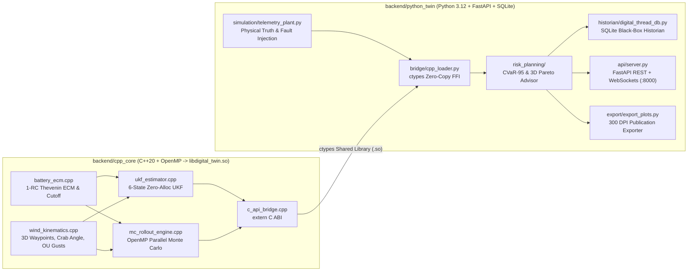

# Project 3 Backend — Hybrid C++20 / Python Digital Twin Engine

This directory implements the two-tier computational backend for the **Mission-Level Digital Twin for UAV Operations**. The architecture separates hard real-time numerical propagation and state estimation from high-level risk analytics, SQL persistence, and web telemetry streaming across a strict `extern "C"` Foreign Function Interface (FFI) boundary.

---

## Architectural Partitioning



### Why C++20 + Python?
Placing the 1-RC Thevenin electro-thermal battery model, 3D wind kinematics, 6-state Unscented Kalman Filter (UKF), and OpenMP Monte Carlo rollout kernel inside a single compiled **C++20 shared library (`libdigital_twin.so`)** guarantees a single mathematical source of truth with zero model mismatch between the estimator and the predictor. The UKF sigma-point transitions directly invoke the same compiled battery and aerodynamics kernels used by the multi-threaded rollout engine, enabling $N = 1,000 - 10,000$ stochastic mission trajectories to execute in milliseconds.

The **Python orchestration layer** loads `libdigital_twin.so` via standard-library `ctypes` (requiring no external C++ binding generators), runs coherent tail-risk analytics ($\text{VaR}_{95\%}$, $\text{CVaR}_{95\%}$, NSGA-II 3D Pareto sorting), persists every mission epoch and injected fault to a relational **SQLite Digital Thread**, and streams live telemetry to the HTML/CSS/JS frontend over **FastAPI WebSockets**.

---

## Directory Structure

```text
backend/
├── README.md
├── cpp_core/                     # C++20 + OpenMP shared library (Physics + UKF + Monte Carlo)
│   ├── README.md
│   ├── CMakeLists.txt
│   ├── include/
│   ├── src/
│   └── tests/
└── python_twin/                  # Python FFI, Risk Analytics, SQLite Historian, FastAPI Server
    ├── README.md
    ├── bridge/
    ├── simulation/
    ├── risk_planning/
    ├── historian/
    ├── api/
    ├── export/
    └── tests/
```

---

## Build and Verification Workflow

```bash
# 1. Build C++20 shared library (libdigital_twin.so) and standalone C++ test binary
cd backend/cpp_core
cmake -B build -DCMAKE_BUILD_TYPE=Release
cmake --build build -j
./build/test_cpp_kernel

# 2. Run Python FFI, physics symmetry, and UKF fault-assimilation unit tests
cd ../..
python3 -m unittest discover -s backend/python_twin/tests -v

# 3. Launch FastAPI Digital Twin server (REST + WebSockets + Swagger at /docs)
uvicorn backend.python_twin.api.server:app --reload --port 8000
```
